# WLED on M5Stack CoreS3

[日本語](readme_jp.md)

WLED v17 firmware runs directly on the M5Stack CoreS3, combining<br>
**local touch control / built-in microphone Audio Reactive / battery status / physical Power Key handling / LED control** in a single device.

> **Status:** Hardware-validated CoreS3 implementation<br>
> **Base:** WLED 17.0.0-devV5<br>
> **Target:** M5Stack CoreS3 (ESP32-S3 / 16MB Flash / 8MB Quad PSRAM)
>
> This is a community-maintained CoreS3 port/extension of WLED and is not an official WLED or M5Stack firmware release.

---

## Features

- WLED firmware runs directly on the M5Stack CoreS3
- Local control with the 320 × 240 touch display
- Lighting changes made in the Web UI are shown on the touch display, and touch controls update the same WLED state
- LED Brightness / Effect / Speed / Intensity / Palette control
- Independent C1 / C2 / C3 multi-color editing
- Preset Call / SAVE / OVERWRITE / DELETE / BOOT PRESET
- Audio Reactive using the built-in ES7210 dual microphones
- Battery level display
- Display Sleep / Wake
- Wi-Fi Offline / Recovery AP UX
- AXP2101 physical Power Key handling
- WLED standard power-off / power-on transitions for long-press and canceled hold
- Clean transition reversal when WLED is turned back on before PMIC hard power-off

---

## Screenshots

The following images show the CoreS3 LCD user interface.

### Main

<p align="center">
  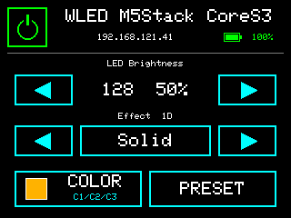
</p>

The MAIN screen provides LED Power, Brightness, Effect, Color, Preset, network status, and battery status.

### Effect

<table>
  <tr>
    <td>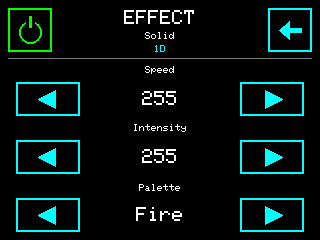</td>
    <td>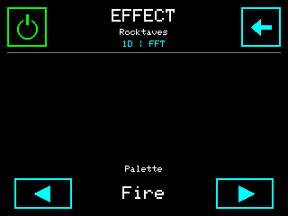</td>
  </tr>
  <tr>
    <td align="center">Standard Effect</td>
    <td align="center">Audio Reactive Effect</td>
  </tr>
</table>

Only parameters that are available for the selected Effect are shown.<br>
Audio Reactive Effects can expose a different parameter set from standard Effects, and the UI follows that dynamically.

### Color

<table>
  <tr>
    <td>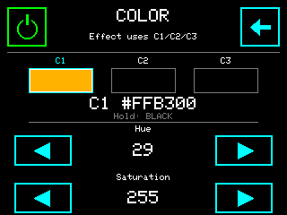</td>
    <td>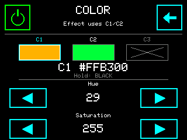</td>
    <td>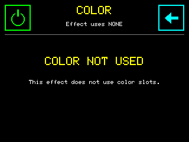</td>
  </tr>
  <tr>
    <td align="center">C1 Edit</td>
    <td align="center">C1 / C2</td>
    <td align="center">Color Not Used</td>
  </tr>
</table>

C1 / C2 / C3 can be selected and edited independently.<br>
When the current Effect does not use a Color Slot, the UI shows `COLOR NOT USED`.

### Preset

<table>
  <tr>
    <td>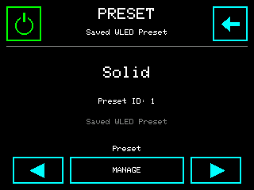</td>
    <td>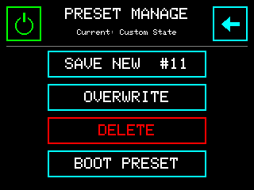</td>
    <td>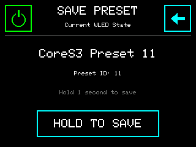</td>
  </tr>
  <tr>
    <td align="center">Preset</td>
    <td align="center">Preset Manage</td>
    <td align="center">Save New</td>
  </tr>
  <tr>
    <td>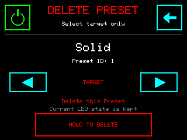</td>
    <td>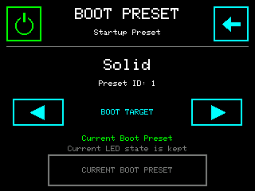</td>
    <td></td>
  </tr>
  <tr>
    <td align="center">Delete Preset</td>
    <td align="center">Boot Preset</td>
    <td></td>
  </tr>
</table>

In addition to recalling Presets, CoreS3 can perform SAVE NEW / OVERWRITE / DELETE / BOOT PRESET operations.

---

## Tested Hardware

### Controller

- M5Stack CoreS3
- ESP32-S3 240 MHz
- 16 MB Flash
- 8 MB Quad PSRAM
- AXP2101 PMIC
- ES7210 audio codec / built-in microphones
- 320 × 240 touch display

### LED

Hardware validation used the M5Stack DIGITAL RGB LED STRIP. M5Stack documents this strip as [SK6812 RGB](https://docs.m5stack.com/en/unit/Unit_RGB_LED_Strip), without a dedicated white channel.

- SK6812 RGB
- 60 LEDs / m
- Two strips connected, for 120 physical LEDs
- WLED Bus Type: `WS281x`
- Color Order: `GRB`
- CoreS3 Port.C
- GPIO17

For LED power-supply sizing, wiring, and common-ground connections, follow the [WLED wiring guide](https://kno.wled.ge/basics/getting-started/). Choose a supply and brightness setting appropriate for the connected LEDs; a brightness value alone does not define the current drawn.

---

## Build Environment

Validated build environment for the public sample:

```text
WLED                  17.0.0-devV5
PlatformIO env        m5stack_cores3
Platform              Tasmota 2026.05.50
Arduino Core          3.3.8.260506
ESP-IDF libraries     5.5.4.260407
NeoPixelBus            2.9.0+sha.76afe83
```

The CoreS3 environment is defined in `platformio_override.ini`.

Key settings:

```ini
[platformio]
default_envs = m5stack_cores3

[env:m5stack_cores3]
extends = env:esp32s3dev_16MB_opi

board_build.arduino.memory_type = qio_qspi
board_build.flash_mode = qio
```

CoreS3-specific usermods:

```text
CoreS3_Power
CoreS3_Display
```

The generic WLED `audioreactive` usermod is also enabled to provide ES7210 support for the CoreS3 built-in microphones.

Audio Reactive definitions:

```text
UM_AUDIOREACTIVE_ENABLE
SR_DMTYPE=10
```

GPIO0 is used for the ES7210 MCLK and is therefore excluded from the WLED physical Button configuration.

---


### Public Build Example

A ready-to-use CoreS3 PlatformIO override example is included at:

```text
usermods/CoreS3_Display/platformio_override.ini.sample
```

Copy it to the WLED repository root and rename it to:

```text
platformio_override.ini
```

The example includes the CoreS3 environment, Quad PSRAM settings, CoreS3 usermods, and Audio Reactive definitions.

## Build

### 1. Requirements

- Visual Studio Code
- PlatformIO IDE
- Git
- USB-C cable

### 2. Open the WLED source tree

Open the WLED repository in VS Code.

Confirm that `platformio_override.ini` exists at the repository root. If it does not, copy `usermods/CoreS3_Display/platformio_override.ini.sample` to the repository root and rename it to `platformio_override.ini`.

### 3. Build

Build the following PlatformIO environment:

```text
m5stack_cores3
```

A successful build ends with:

```text
Environment     Status
--------------  -------
m5stack_cores3  SUCCESS
```

### 4. Upload

Upload the `m5stack_cores3` environment from PlatformIO.

If another serial monitor or program is holding the COM port open, close it before Upload.


---

## Power Management

### DCDC3 Always-PWM

During investigation of unexpected complete CoreS3 power-offs, DCDC OVP was observed multiple times in the AXP2101 `PWROFF_STATUS`.

The CoreS3 Power usermod uses DCDC3 Always-PWM as a stabilization measure.

```text
DCDC1: AUTO
DCDC3: ALWAYS_PWM
OVP protection: kept active
```

Long-duration hardware testing and regression checks showed strong stabilization with this setting.

> This does not claim that DCDC3 itself was proven to be the sole hardware root cause.<br>
> In this project, DCDC3 Always-PWM is treated as a stabilization measure that has been strongly validated on real hardware.

### Power Key Handling

Holding the physical CoreS3 Power Key requests the normal WLED power-off path before the AXP2101 performs the final PMIC hard power-off.

The CoreS3 usermod does not force LED output directly. It uses WLED's standard power transition handling so brightness state, transition reversal, and other WLED power behavior remain under core control.

Processing sequence:

```text
Power Key long press
        ↓
WLED standard OFF transition
        ↓
LED output reaches OFF
        ↓
AXP2101 hard power-off
```

If the Power Key is released before the final PMIC hard power-off, the usermod requests the normal WLED power-on path when appropriate.

If WLED is turned back on from the Web UI while the power-off transition is still running, the standard WLED transition can reverse and restore the active effect without CoreS3-specific LED output overriding it.

---

## Audio Reactive

The built-in ES7210 and CoreS3 microphones are used.

Main settings:

```text
Codec          ES7210
I2S            I2S0
Sample Rate    22050 Hz
Codec Format   24-bit I2S
I2S Input      Mono / WLED 32-bit container
MCLK           GPIO0
DIN            GPIO14
```

---

## Touch UI

Main screens:

```text
MAIN
COLOR
EFFECT
PRESET
PRESET MANAGE
```

The touch display and Web UI control the same WLED instance. Lighting changes made through either interface are reflected in the other.

Use the WLED Web UI for segment configuration.

Short press / long press / drag touch operations are supported.

---

## Preset Management

The following operations are available from the CoreS3 touch display:

```text
Preset Call
SAVE NEW
OVERWRITE
DELETE
BOOT PRESET
```

---

## Network Recovery

When neither a Wi-Fi connection nor an access point is available, the MAIN screen shows `Offline - Hold Recovery AP`. Hold that network-status area for 1.5 seconds to start a temporary Recovery AP.

The Recovery AP password is `wled1234` unless `WLED_AP_PASS` was overridden at build time.

Connect to the access point whose name is shown on the display, then open:

```text
http://4.3.2.1
```

Starting Recovery AP does not change the saved AP credentials or AP behavior setting.

---

## Battery Status

The MAIN screen displays the battery percentage reported by the CoreS3's AXP2101 power-management IC.

---

## Project Structure

The CoreS3-specific usermods are `CoreS3_Power` and `CoreS3_Display`.
The generic WLED `audioreactive` usermod also contains the ES7210 source used by the CoreS3 configuration.

```text
WLED/
├─ platformio_override.ini
└─ usermods/
   ├─ CoreS3_Power/
   ├─ CoreS3_Display/
   └─ audioreactive/
```

### CoreS3_Power

Responsibilities:

- AXP2101
- AW9523B
- External 5V
- DCDC3 Always-PWM
- Power Key
- WLED Power Transition
- Power initialization and external 5V status

### CoreS3_Display

Responsibilities:

- M5GFX
- Touch
- Local UI
- Battery display
- Wi-Fi status
- Preset UI

### audioreactive

The audioreactive usermod supports the CoreS3 built-in microphones with a new ES7210 digital-microphone type.

---

## Acknowledgements

- WLED project and contributors
- M5Stack
- NeoPixelBus
- Audio Reactive / WLED usermod contributors

This project builds on the work of many open-source projects and contributors.
