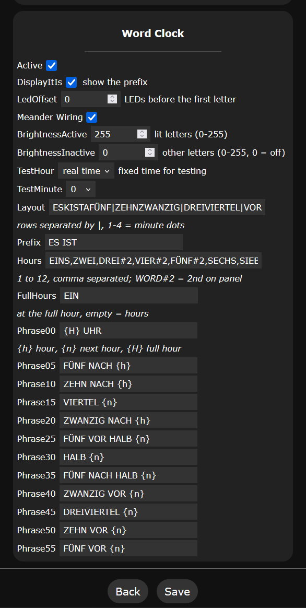

# Word Clock Usermod V2

This usermod drives a word clock with WLED: one LED behind every letter of the front panel, plus up to 4 dots for the single minutes.
The front panel and all words are settings, so the usermod works with any layout and any language without changing code.
The defaults are the German 11x10 panel from earlier versions of this usermod.

## How it works

Most word clock languages follow the same pattern: there is one phrase for every 5 minutes, and each phrase names either the current or the next hour.
The usermod only knows this pattern. The words and the front panel come from the settings.

Every minute the usermod:

1. takes the phrase for the current 5 minutes, e.g. `phrase25` = `FÜNF VOR HALB {n}` at 3:25,
2. replaces the hour placeholder with the word from `hours`: `FÜNF VOR HALB VIER`,
3. puts the `prefix` in front if `displayItIs` is enabled: `ES IST FÜNF VOR HALB VIER`,
4. searches each word in the `layout` and lights its LEDs,
5. lights one minute dot per minute after the 5 minutes (3:27 shows two dots).

Until the time is known (NTP or another time source), no time is shown: all letters and minute dots get `brightnessInactive`, so with the default 0 the clock stays dark.

Earlier versions had fixed LED numbers for the German panel in the code.
Other languages or panels needed code changes, and "Norddeutsch" was a separate switch.
Now all of this is in the settings, including umlauts, which are entered as normal text.

## Settings

All settings are on the Usermod Settings page:



The settings in the order of the page (default in brackets):

* `active`: enable/disable the usermod (off)
* `displayItIs`: show the `prefix` ("Es ist") in front of the time (off)
* `ledOffset`: number of LEDs before the first letter (100)
* `Meander wiring?`: enable for meander (serpentine) wiring, see Wiring (off)
* `brightnessActive`: brightness of the lit letters and minute dots, 0-255 (255). The colors come from the WLED effect; 255 leaves them unchanged.
* `brightnessInactive`: brightness of all other letters and minute dots, 0-255 (0). 0 switches them off; a low value keeps the whole panel faintly visible.
  Both are applied on top of the WLED brightness, they do not replace it: WLED at 50% and `brightnessInactive` 64 (25%) gives about 12.5%.
* `testHour`, `testMinute`: show a fixed time to check a panel, e.g. 15 and 27 (-1 and 0). `testHour` -1 shows the real time. The test time also works before the time is synchronized.
* `layout`: the letters of the front panel in reading order, rows separated by `|` (German panel, see Presets). Every character except `|` is one LED.
  The characters `1` to `4` are the minute dots and can be anywhere on the panel: dot `1` is lit from 1 minute after the 5 minutes, dot `2` from 2 minutes, and so on.
  The default ends with `|1234`: 4 dots as an extra row after the letters.
  A layout can have up to 32 rows, including a row of minute dots.
* `prefix`: words shown in front of the time when `displayItIs` is enabled (`ES IST`)
* `hours`: the words for the hours 1 to 12, separated by commas
* `fullHours`: words used at the full hour instead of `hours`, separated by commas (`EIN`). Empty entries use `hours`, so `EIN` alone makes "EIN UHR" instead of "EINS UHR". Only hours that differ need an entry; to change a later hour, leave the entries before it empty, e.g. `,,DREI#3` sets only the word for 3 o'clock.
* `phrase00` ... `phrase55`: the words for each 5 minutes. `{h}` is replaced by the current hour, `{n}` by the next hour and `{H}` by the current hour from `fullHours`.

Words are separated by spaces and searched in the order of the sentence, each one after the previous match.
This takes a word that appears several times on the panel from the right place.
Where the order cannot decide, `WORD#2` selects the 2nd occurrence on the whole panel, e.g. `DREI#2` for the hour DREI, because the first DREI is part of DREIVIERTEL.
A word must be within one row. Upper and lower case must match the layout.

If a word appears several times, check which one is lit: the first match after the previous word is not always the one you want (e.g. "IT IS A QUARTER" on a panel with another A right after IS).

The settings are checked at every start and after saving. The info page shows:

* `Word clock`: "settings OK", the first time with a word that was not found (e.g. `1:30: 'HALP' not found`), "inactive" or "waiting for time sync"
* `Word clock time`: the time shown, marked "(test)" for the test time
* `Word clock text`: the lit words, the minutes past the 5-minute step (the minute dots) and the number of lit LEDs, e.g. `ES IST FÜNF VOR HALB VIER + 3 min (25 LEDs)`

## Presets

German (default):

```text
layout:    ESKISTAFÜNF|ZEHNZWANZIG|DREIVIERTEL|VORFUNKNACH|HALBAELFÜNF|EINSXAMZWEI|DREIPMJVIER|SECHSNLACHT|SIEBENZWÖLF|ZEHNEUNKUHR|1234
prefix:    ES IST
hours:     EINS,ZWEI,DREI#2,VIER#2,FÜNF#2,SECHS,SIEBEN,ACHT,NEUN,ZEHN#2,ELF,ZWÖLF
fullHours: EIN
phrase00 ... phrase55:
  {H} UHR | FÜNF NACH {h} | ZEHN NACH {h} | VIERTEL {n} | ZWANZIG NACH {h} | FÜNF VOR HALB {n}
  HALB {n} | FÜNF NACH HALB {n} | ZWANZIG VOR {n} | DREIVIERTEL {n} | ZEHN VOR {n} | FÜNF VOR {n}
```

For "viertel nach" / "viertel vor" use `VIERTEL NACH {h}` for `phrase15` and `VIERTEL VOR {n}` for `phrase45`.
Configurations with the former `Norddeutsch` setting are converted to these phrases automatically.

Dutch:

```text
layout:    HETKISAVIJF|TIENBTZVOOR|OVERMEKWART|HALFSPWOVER|VOORTHGEENS|TWEEPVCDRIE|VIERVIJFZES|ZEVENONEGEN|ACHTTIENELF|TWAALFPMUUR|1234
prefix:    HET IS
hours:     EEN,TWEE,DRIE,VIER,VIJF#2,ZES,ZEVEN,ACHT,NEGEN,TIEN#2,ELF,TWAALF
fullHours: (empty)
phrase00 ... phrase55:
  {h} UUR | VIJF OVER {h} | TIEN OVER {h} | KWART OVER {h} | TIEN VOOR HALF {n} | VIJF VOOR HALF {n}
  HALF {n} | VIJF OVER HALF {n} | TIEN OVER HALF {n} | KWART VOOR {n} | TIEN VOOR {n} | VIJF VOOR {n}
```

English:

```text
layout:    ITLISASAMPM|ACQUARTERDC|TWENTYFIVEX|HALFSTENFTO|PASTERUNINE|ONESIXTHREE|FOURFIVETWO|EIGHTELEVEN|SEVENTWELVE|TENSEOCLOCK|1234
prefix:    IT IS
hours:     ONE,TWO,THREE,FOUR,FIVE#2,SIX,SEVEN,EIGHT,NINE,TEN#2,ELEVEN,TWELVE
fullHours: (empty)
phrase00 ... phrase55:
  {h} OCLOCK | FIVE PAST {h} | TEN PAST {h} | QUARTER PAST {h} | TWENTY PAST {h} | TWENTY FIVE PAST {h}
  HALF PAST {h} | TWENTY FIVE TO {n} | TWENTY TO {n} | QUARTER TO {n} | TEN TO {n} | FIVE TO {n}
```

## Upgrading from earlier versions

The defaults light exactly the same LEDs as the fixed German panel of earlier versions, so an existing clock keeps working after the update.
`active`, `displayItIs`, `ledOffset` and `Meander wiring?` are kept.
If `Norddeutsch` was enabled, `phrase15` and `phrase45` are set to `VIERTEL NACH {h}` and `VIERTEL VOR {n}`.
The new settings are added to the configuration at the first start after the update.
One visible difference: until the time is synchronized after a start, no time is shown (dark with the default `brightnessInactive` 0). Earlier versions showed 12 o'clock until then.

## Wiring

The LED strip starts at the first letter of the top row, after `ledOffset` LEDs. The rows of the `layout` are the rows of the wiring:

* `Meander wiring?` off: every row runs from left to right. At the end of a row, a long wire goes back to the left of the next row.
* `Meander wiring?` on (serpentine): the 1st row runs from left to right, the 2nd from right to left, the 3rd from left to right again, and so on.

With meander wiring, each reversed row is mirrored with its own length, so rows of different length work too.
The minute dot row `1234` at the end of the default layout is the 11th row, so it runs from left to right.
If your dots are wired in a different order, change their order in the layout, e.g. `|4321`.

## Installation

Add the usermod to `custom_usermods` of your build environment, for example in `platformio_override.ini`:

```ini
[env:wordclock_esp32]
extends = env:esp32dev
custom_usermods = usermod_v2_word_clock
```

### PlatformIO requirements

No special requirements.

## Change Log

2026/10/19 front panel layout, hours and phrases are settings; any language can be used.
Minute dots anywhere in the layout, brightness of lit and other letters, test time, time and lit words on the info page; no time is shown until the time is synchronized.

2022/08/18 added meander wiring pattern.

2022/03/30 initial commit
